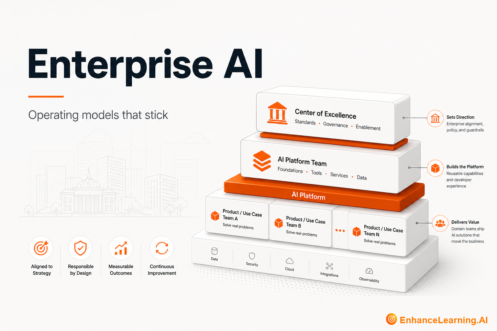

  

# Enterprise AI: Operating Models, Maturity, and Transformation That Stick

> Maintained reading path from [EnhanceLearning.AI](https://enhancelearning.ai) — practitioner-grade articles for engineers, architects, and technology leaders building production AI-native systems.

**Topic on the site:** [Enterprise AI](https://enhancelearning.ai/articles?category=Enterprise+AI) · **Full library:** [enhancelearning.ai/articles](https://enhancelearning.ai/articles)

## What this repo is

A curated reading path for **Enterprise AI**. It is not a code SDK — it points to the foundation deep-dives on [EnhanceLearning.AI](https://enhancelearning.ai) so you can align on concepts, critique designs, and ship production systems that hold up.

These articles cover enterprise operating models, CoE vs platform team roles, maturity models you can use, transformation that starts with organization design, and why initiatives fail before production.

## Who it's for

Technology leaders, CoE operators, and architects aligning AI delivery with enterprise reality.

## Foundation articles

- [Why Most Enterprise AI Initiatives Fail Before Reaching Production](https://enhancelearning.ai/articles/why-most-enterprise-ai-initiatives-fail-before-production) — Enterprise AI stalls in pilots because ownership, incentives, and governance are misaligned — not because the model is wrong.
- [AI Transformation Starts With the Organization, Not the Model](https://enhancelearning.ai/articles/ai-transformation-starts-with-the-organization-not-the-model) — Workflow redesign, ownership, and incentives determine AI outcomes more than model selection — challenge the tech-first assumption.
- [Building an Enterprise AI Operating Model](https://enhancelearning.ai/articles/building-an-enterprise-ai-operating-model) — How enterprises adopt AI through job classes, shared platforms, eval gates, and controls — instead of scattered chat pilots.
- [The Difference Between an Enterprise AI CoE and an AI Platform Team](https://enhancelearning.ai/articles/difference-between-enterprise-ai-coe-and-ai-platform-team) — Enterprise AI CoE sets standards and enablement; AI platform teams ship shared infrastructure — know the split to avoid role confusion.
- [How an AI CoE Scales Enterprise Adoption](https://enhancelearning.ai/articles/how-an-ai-coe-scales-enterprise-adoption) — A well-scoped AI CoE accelerates standards, shared learning, and cross-BU reuse — without owning every use case.
- [An Enterprise AI Maturity Model You Can Actually Use](https://enhancelearning.ai/articles/an-enterprise-ai-maturity-model-you-can-actually-use) — Assess enterprise AI readiness across people, process, data, and operating model — a diagnostic for sequencing capability building.
- [Why Enterprise AI Operating Models Need Periodic Redesign](https://enhancelearning.ai/articles/why-enterprise-ai-operating-models-need-periodic-redesign) — Enterprise AI operating models must evolve with capability, maturity, and priorities — not stay frozen after a one-time setup.

## More from EnhanceLearning.AI

- Homepage: [https://enhancelearning.ai](https://enhancelearning.ai)
- All articles: [https://enhancelearning.ai/articles](https://enhancelearning.ai/articles)
- This topic filter: [Enterprise AI](https://enhancelearning.ai/articles?category=Enterprise+AI)
